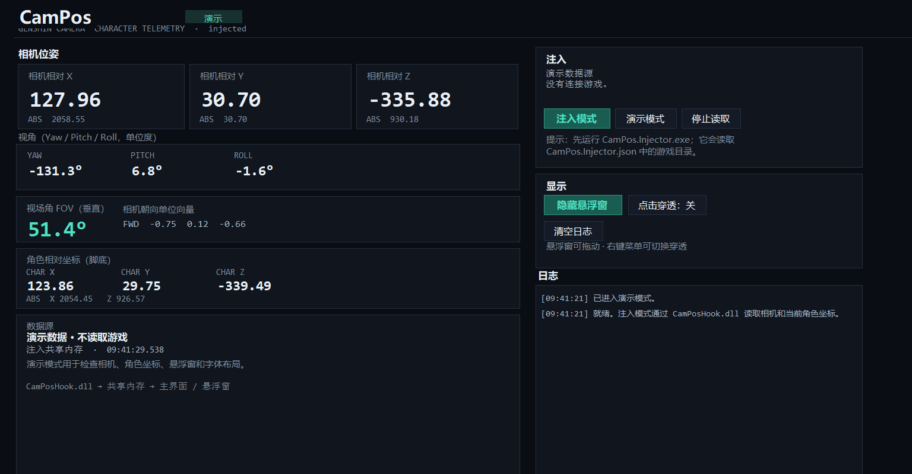

# CamPos · 原神相机与角色坐标监视器

CamPos 是一个 Windows x64 的《原神》进程内遥测工具。它通过注入 `CamPosHook.dll` 读取：

- 当前主相机的场景坐标和相对于场景参考物的水平坐标（界面标为 `ABS`）
- 相机 Yaw / Pitch / Roll、朝向单位向量；
- 相机垂直 FOV；
- **当前场上角色的场景坐标和 ABS 坐标**。

界面提供置顶悬浮窗和点击穿透。

> **风险提示**
>
> 注入会修改游戏进程内的 `Camera.set_fieldOfView` 入口，并调用 Unity 的 Transform 访问器读取角色位置。这是明确违反游戏 ToS 的高风险行为，可能导致封号。请只在测试账号或你愿意承担损失的环境使用。



> 截图来自演示模式；真实注入数据使用同一套布局。

## 功能

- 相机相对坐标 X / Y / Z（Unity 场景坐标）
- 相机 ABS 坐标（X / Z 减去场景参考物的位置，Y 沿用场景高度）
- Yaw / Pitch / Roll（度）
- 相机朝向单位向量
- 垂直 FOV（度）
- 角色相对坐标 X / Y / Z（当前活动角色的 Transform 原点）
- 角色 ABS 坐标（X / Z 与相机使用同一参考物）
- 置顶悬浮窗：拖动、透明度、点击穿透；通过按钮或右键菜单操作，无全局快捷键
- 演示模式：不连接游戏也能检查 UI 和布局
- 30 Hz 共享内存传输，界面只读共享内存

## 运行环境

- Windows 10/11 x64
- .NET 10 Desktop Runtime（framework-dependent 构建）
- 原神 PC 客户端 **7.2.0**（国际服 GenshinImpact.exe / 国服 YuanShen.exe）
- 管理员权限（注入器需要创建挂起进程、写入远程内存、创建远程线程）

## 配置文件（必须手动指定游戏目录）

CamPos **不会**搜索注册表、启动器配置或默认安装路径。注入器只读取同目录的：

~~~text
CamPos.Injector.json
~~~

默认内容随发行包提供；请按自己的安装位置修改：

~~~json
{
  "GameDirectory": "C:/Program Files/miHoYo Launcher/games/Genshin Impact Game"
}
~~~

字段说明：

| 字段 | 必填 | 说明 |
|---|---|---|
| GameDirectory | 是 | 原神安装文件夹，不是 exe 路径。必须存在。 |
| GameExecutable | 否 | 文件名，例如 GenshinImpact.exe 或 YuanShen.exe。文件夹里同时有两个 exe 时必须填写。 |
| Arguments | 否 | 追加给游戏的命令行参数。一般留空。 |

如果目录里同时存在国际服和国服 exe，请写成：

~~~json
{
  "GameDirectory": "D:/Games/Genshin Impact Game",
  "GameExecutable": "GenshinImpact.exe"
}
~~~

注意：

- JSON 字符串里的反斜杠要写成两个反斜杠，或者直接使用正斜杠，例如 D:/Games/Genshin Impact Game。
- GameDirectory 只写到文件夹，不要写 GenshinImpact.exe。
- 修改后保存为 UTF-8。
- 配置文件缺失、目录不存在、找不到 exe、两个 exe 同时存在但没有指定 GameExecutable，注入器都会直接报错退出。

同目录的 CamPos.Injector.example.json 是模板；可以复制为 CamPos.Injector.json 后编辑。也可以用 --config 指定另一份配置（主要用于测试）。

## 使用步骤

1. **完全退出游戏**，包括后台残留的 GenshinImpact.exe / YuanShen.exe。
2. 编辑 CamPos.Injector.json，确认 GameDirectory 指向你的原神安装目录。
3. 右键以管理员身份运行 CamPos.Injector.exe。
   - 它读取 JSON，解析出唯一的游戏 exe；
   - 以 CREATE_SUSPENDED 启动游戏；
   - 用 VirtualAllocEx + WriteProcessMemory + CreateRemoteThread(LoadLibraryW) 加载同目录的 CamPosHook.dll；
   - 恢复主线程后退出。
4. 登录并进入大世界（角色站在场景里，能看到角色和场景）。
5. 运行 CamPos.exe --injected，或者普通启动后点击 **注入模式**。
6. 点击 **显示悬浮窗**，把窗口拖到合适位置。

### 命令行

~~~text
CamPos.exe [--demo] [--injected]
CamPos.Injector.exe [--config <json>] [--dll <dll>] [--args <args>]
~~~

- --demo：演示数据，不连接游戏。
- `--injected` 会在启动时查找共享内存。数据源稍后启动时，查看器每 0.5 秒重试，直到连接成功或停止读取。
- --config：使用另一份注入器 JSON；默认是同目录的 CamPos.Injector.json。
- --dll：使用另一个 hook DLL；默认是同目录的 CamPosHook.dll。
- --args：覆盖 JSON 里的 Arguments。

## 悬浮窗


> 悬浮窗截图同样来自演示模式。

左键拖动；右键菜单可以显示主窗口、切换点击穿透或隐藏。

## 数据来源

### 相机

CamPosHook.dll 在游戏主线程恢复前 hook：

- 国际服 GenshinImpact.exe：模块基址 + 0x1467230
- 国服 YuanShen.exe：模块基址 + 0x1466230

目标函数是 Camera.set_fieldOfView。Hook 先检查 14 字节函数序言：

~~~text
40 53 48 83 EC 30 0F 29 74 24 20 0F 28 F1
~~~

不匹配就拒绝 hook。匹配后用 14 字节绝对跳转覆盖入口，trampoline 保存原指令并跳回。

从 IL2CPP 的 Camera 对象：

- Camera + 0x10：native Camera 指针
- native Camera + 0x1680：camera-to-world 矩阵（行主序，最后一行是相机世界坐标）
- native Camera + 0x8d8：透视投影矩阵；m11 对应垂直 FOV
- 位置取矩阵 [12..14]
- 右/上/后取矩阵前三行，前向 = -back
- FOV = 2 * atan(1 / |m11|) * 180 / pi

只接受名称以 MainCamera 开头的主相机，避免 UI/过场相机覆盖共享状态。

### 角色坐标

角色坐标不再通过外部 RPM 扫描，而是从 Unity 场景层级读取：

1. 从主相机 Component 取得 Transform；
2. 从相机 Transform 的父节点（/EntityRoot）找到名为 AvatarRoot 的子节点；
3. 遍历 AvatarRoot 的子节点，取 activeInHierarchy == true 的那个（当前场上角色）；
4. 调用 Unity 的 `Transform.get_position`，读取该角色节点在当前场景中的世界坐标。

7.2.0 的 Unity 访问器实现入口（native 函数，不是托管 thunk）：

| 功能 | 国际服 RVA | 国服 RVA |
|---|---:|---:|
| Component.get_transform | 0x1465cf0 | 0x1464cf0 |
| Component.get_gameObject | 0x1465d40 | 0x1464d40 |
| Object.get_name | 0x144a820 | 0x1449820 |
| Transform.get_position | 0x1448b30 | 0x1447b30 |
| Transform.get_parent | 0x14492e0 | 0x14482e0 |
| Transform.get_childCount | 0x1449b40 | 0x1448b40 |
| Transform.GetChild | 0x1449ea0 | 0x1448ea0 |
| GameObject.get_activeInHierarchy | 0x1464f90 | 0x1463f90 |

国服这张表的地址统一比国际服低 0x1000；Camera.set_fieldOfView 则低 0x10000。这些偏移只对应 7.2.0；游戏更新后需要重新定位。

### ABS 坐标与传送落点

相机和角色的普通 X / Y / Z 都是当前 Unity 场景的世界坐标。CamPos 取 `OtherRoot/New Game Object` 的场景位置作为水平坐标的参考。界面所称的“绝对坐标”（ABS）对相机和角色使用同一公式。

~~~text
ABS X = 场景 X - 参考物 X
ABS Y = 场景 Y
ABS Z = 场景 Z - 参考物 Z
~~~

相机或角色与参考物一起平移时，共有的水平位移会在相减时抵消。要使 ABS 与地图的 X / Z 一致，参考物在该地图坐标系中的 X / Z 须为 `(0, 0)`。收到有效的相机帧但缺少参考物时，主界面的 ABS 显示为 `—`，悬浮窗隐藏对应的 ABS 行。

场景数据中的 `pos` 表示传送点实体的摆放位置，`tranPos` 表示为角色配置的传送到达位置。下面两次实测都在角色落地站稳、尚未走动时，记录**角色栏**的 ABS X / Z，并与对应点位的 `tranPos` 比较。[场景 3 点位数据](https://raw.githubusercontent.com/DimbreathBot/AnimeGameData/d54f6f0d423ded9d055bb740a3e5f3aa8f2667f1/BinOutput/Scene/Point/scene3_point.json)

| 七天神像（场景 3 点位 ID） | 神像 `pos` (X, Z) | 配置到达位置 `tranPos` (X, Z) | 实测角色 ABS (X, Z) |
|---|---|---|---|
| 风起地（4） | (1928.381, -1265.917) | (1934.3658, -1266.3422) | (1934.37, -1266.34) |
| 星落湖（7） | (2566.115, -1323.474) | (2564.5361, -1329.8206) | (2564.54, -1329.82) |

这两处的角色场景 X / Z 均显示为 `(0.00, 0.00)`，ABS X / Z 均与 `tranPos` 四舍五入至两位小数后的值一致。

`tranPos.y` 是配置的到达高度。据实测者说明，传送时角色先出现在地面上方，展开风之翼后下降。这样能给加载较慢的设备留出载入地形的时间，降低角色卡入地面的风险。截图中的 ABS Y 是采样时角色站稳后的场景高度。风起地实测 `195.57`，比配置的 `196.139` 低约 `0.57`。星落湖实测 `213.57`，比配置的 `215.3869` 低约 `1.82`。

普通坐标和朝向随最新帧刷新。ABS 使用已获得后续参考物读数确认的历史帧，界面上的“ABS 延迟”是这两帧的时间差。参考物变化或失效时，查看器会清除待确认的 ABS。v4 使用参考物的实际采样时间。旧版 v3 只有整帧时间，查看器按参考物最长 1.5 秒的缓存期进行确认。稳定读取时 v3 的 ABS 通常落后约 1.5 秒。首次连接或参考物变化后，角色 ABS 还需等旧角色样本最多 1 秒的缓存期过去。

### 共享内存

原生源码每约 33 ms 向 `Global\CamPosState_v4` 发布一帧，无法创建时使用 `Local\CamPosState_v4`。v4 状态按 4 字节对齐，共 116 字节。

连接成功时，右侧日志会显示实际打开的映射名称。“未找到”表示四个 v4/v3 名称均未找到。“Windows 拒绝读取”会列出具体映射。“等待有效的相机数据”表示查看器已识别协议头，正在等第一帧有效数据。

~~~text
uint Magic; uint Version; uint Valid; uint Sequence; uint Tick;
float Px, Py, Pz;          // 相机世界坐标
float Fx, Fy, Fz;          // 相机前向
float Ux, Uy, Uz;          // 相机上向
float Rx, Ry, Rz;          // 相机右向
float Fov; float Aspect;
uint PlayerValid;
float PlayerX, PlayerY, PlayerZ;  // 活动角色 Transform 的场景坐标
uint AbsoluteValid;               // 有近期可用的场景参考物读数
float OriginX, OriginZ;           // 场景参考物的 X/Z，供界面计算 ABS
uint PlayerTick, OriginTick;       // 角色与参考物各自的采样时刻（毫秒）
uint OriginGeneration;           // 参考物坐标改变或失效后重新取得时递增
~~~

v4 写入快照时将 `Sequence` 更新为奇数，完成后再更新为偶数。查看器在复制前后核对同一偶数序号。查看器也兼容原有的 `Global\CamPosState_v3` 和 `Local\CamPosState_v3`（104 字节），通过重复读取筛除可观测到的半帧。v3 没有发布序号和参考物代次，短暂且未被轮询捕捉的变化无法从这份数据识别。

## 构建

需要 .NET 10 SDK：

~~~powershell
dotnet build CamPos.sln -c Release
~~~

发布完整发行包：

~~~powershell
./build.ps1
~~~

输出到 dist/CamPos：

- CamPos.exe：主界面
- CamPos.Injector.exe：启动游戏并注入
- CamPosHook.dll：7.2.0 原生 hook
- CamPos.Injector.json：当前配置
- CamPos.Injector.example.json：模板
- docs/、LICENSE、README.md

build.ps1 不会自动编译 CamPosHook.dll。仓库里的 DLL 是 7.2.0 预编译版本。重新编译需要 64 位 C 编译器；本机使用 MSYS2 UCRT64 GCC：

~~~powershell
$env:PATH = 'C:/msys64/ucrt64/bin;' + $env:PATH
gcc -m64 -shared -O2 -o native/CamPosHook.dll native/CamPosHook.c -lkernel32 -lmsvcrt
~~~

MSVC 也可以：

~~~text
cl /LD /O2 CamPosHook.c /link /OUT:CamPosHook.dll
~~~

本项目不使用任何第三方运行时 NuGet 包，也不依赖 MelonLoader、BepInEx 或 Il2CppInterop。

## 安全与合规

注入模式会：

- 读取 JSON 后以挂起方式启动游戏；
- 向游戏进程写入 DLL 路径并创建远程线程；
- 在 Camera.set_fieldOfView 入口写入 inline hook；
- 从游戏内调用 Unity 的 Transform 访问器；
- 创建共享内存。

## 目录结构

~~~text
src/CamPos.Core/          相机/角色共享内存读取、姿态数学、配置、监视器
src/CamPos.App/           WinForms 主界面、悬浮窗
src/CamPos.Injector/      读取 JSON、启动游戏、注入 CamPosHook.dll
native/CamPosHook.c       进程内 FOV hook、相机矩阵、角色 Transform、共享内存
native/CamPosHook.dll     7.2.0 预编译 hook
docs/                     界面截图
~~~

## 参考

- [genshin-unlock](https://github.com/z3lx/genshin-unlock)：7.2.0 set_fieldOfView 偏移与早期注入思路。
- [genshin-fps-unlock](https://github.com/34736384/genshin-fps-unlock)：确认“父进程创建 + 早期注入”的可行性。
- [CameraTools](https://github.com/portra400nc/CameraTools)：Unity 场景路径 /EntityRoot/MainCamera(Clone)、/EntityRoot/AvatarRoot 的行为参考。
- genshin-il2cpp-re：7.2.0 IL2CPP 元数据与 Unity 访问器 RVA 的静态分析参考。

本项目没有复用上述项目的二进制或代码；数学、UI、注入器、hook 和共享内存均为独立实现。

## License

GNU General Public License v3.0（GPLv3）。Copyright (C) 2026 CamPos contributors。见 [LICENSE](LICENSE)。

## 一键导出 Minecraft 地名

Windows 安装 Python 3.8 或更高版本后，在文件资源管理器中双击仓库根目录的 [export-area-hints.cmd](export-area-hints.cmd)。脚本每次联网确认 `main` 当前的提交，在同一提交下下载区域表、中文地名和场景边界，并按 Git 文件哈希复用本地缓存。[数据来源](https://github.com/DimbreathBot/AnimeGameData)

完成后打开 `exports/area-hints-genshin-<版本与提交>/`。其中 `area-hints.zip` 是完整导入包，`all/scene-3/overworld.json` 是提瓦特全部区域，`tips-only/scene-3/overworld.json` 仅包含 `showTips=true` 的区域。其他场景各有独立文件。转换使用 `MC (X, Y, Z) = 原神 (-Z, Y, -X)`，比例为 1:1。区域 ID、缺少边界的条目和名称映射保存在包内的 `reference/areas-index.json`。

在命令行中可以固定上游提交以复现历史版本，也可以用 `--output` 指定输出目录。

```powershell
.\export-area-hints.cmd --ref d54f6f0d423ded9d055bb740a3e5f3aa8f2667f1
```